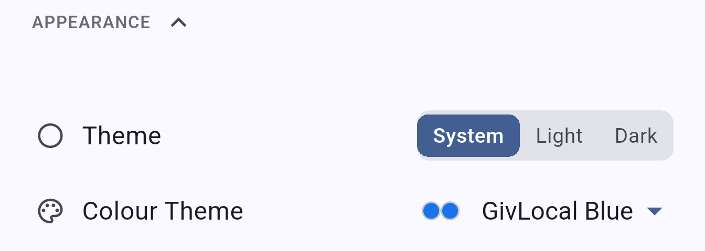

Open **Settings → Appearance** to change how GivLocal looks.

## Theme

Choose between three modes:

| Mode | Description |
|------|-------------|
| System | Follows your device's light/dark mode setting |
| Light | Always uses the light theme |
| Dark | Always uses the dark theme |

## Colour theme

GivLocal includes five colour palettes:

| Theme | Description |
|-------|-------------|
| GivLocal Blue | The default blue accent theme |
| Solar Teal | Teal-green accent |
| Copper Teal | Warm copper with teal highlights |
| Moss Amber | Earthy green and amber |
| High Contrast | Maximum contrast for improved readability |

The **High Contrast** theme is designed for use in bright outdoor environments where the standard themes may be harder to read.

