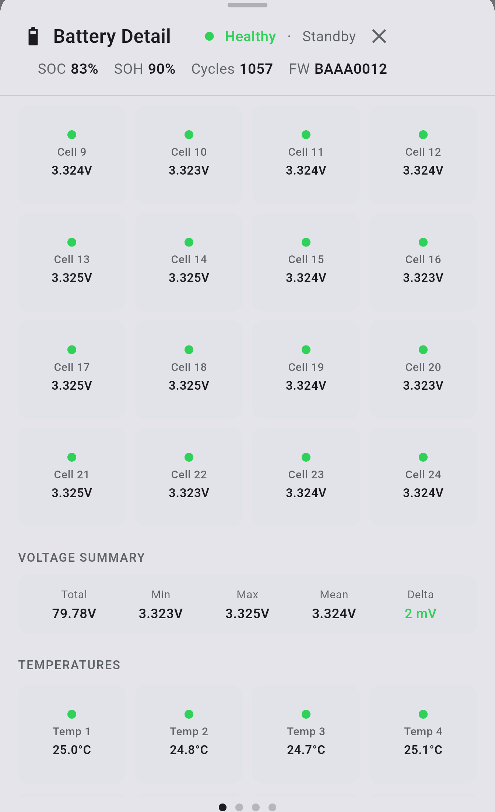

Tapping the battery card on the Dashboard opens a detailed cell-level view of your battery. The data shown depends on your battery type.

## What's shown

### LV batteries
- Per-cell voltage (mV)
- Temperature readings
- Calculated State of Health (when BMS capacity data is available)

### HV batteries (BMU)
- Per-pack cell voltages
- BMU and BCU pack data shown separately
- Temperature per group or per cell depending on battery type

## State of Health

When your battery's BMS reports capacity data, GivLocal calculates and displays a State of Health percentage. This reflects how much usable capacity remains relative to the original design capacity.

To enable State of Health display, turn on **Show Calculated State of Health** in **Settings → Battery Diagnostics**.

## Screenshots needed
- Battery cell detail sheet — HV battery (BMU/BCU pack view); no HV battery hardware was available to capture this
